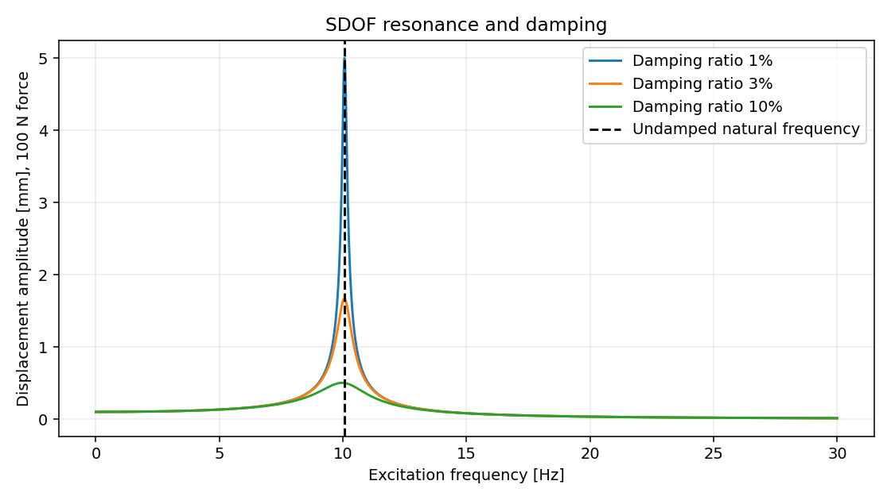
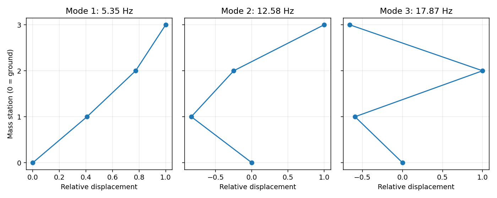
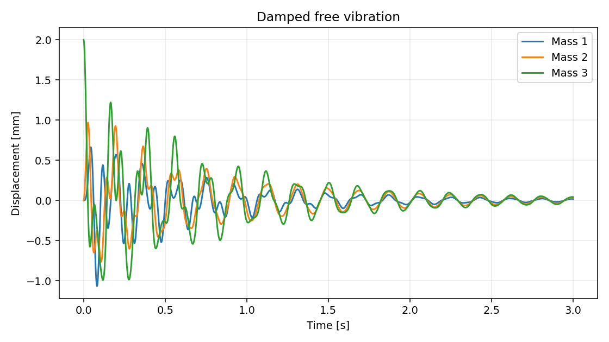
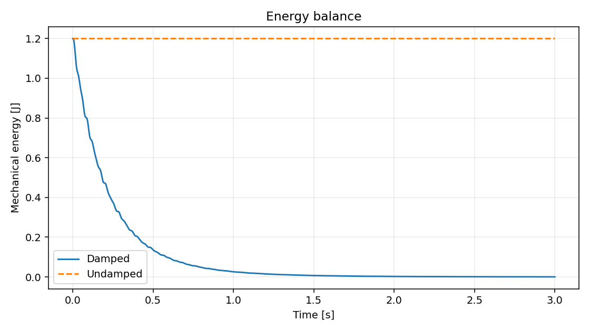
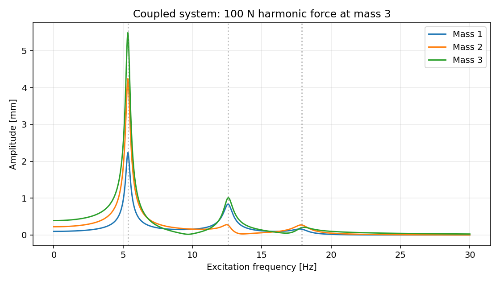
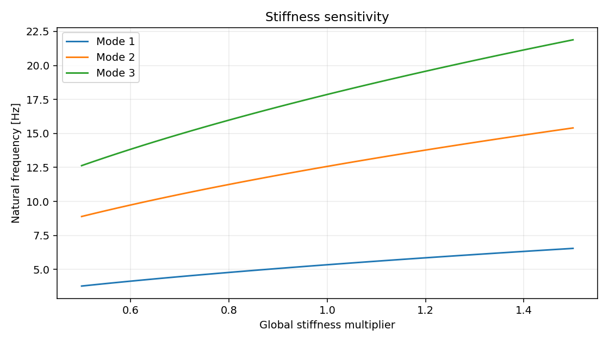

# VibraStruct — Technical Report

## Purpose and scope
An educational numerical study of resonance, modal behaviour and damping in an idealised mechanical support system. Parameters are synthetic: no refinery measurements or proprietary data are used. This is a computational demonstration, not a calibrated model of industrial equipment.

## Models and assumptions
The SDOF baseline has mass 250 kg, stiffness 1e+06 N/m and viscous damping ratio 0.03. The three-degree-of-freedom chain has masses [250, 180, 120] kg and springs [1000000.0, 800000.0, 600000.0] N/m. Its topology is ground–spring 1–mass 1–spring 2–mass 2–spring 3–mass 3; the right end is free. Every mass translates along one axis. Small displacements, linear springs, constant lumped masses and viscous damping are assumed. Rotations, nonlinear contacts, foundation flexibility and fluid forces are excluded.

## Governing equations
M x'' + C x' + K x = f(t). Natural modes satisfy K phi = omega² M phi and are normalized so Phiᵀ M Phi = I. Frequency is omega/(2 pi). Rayleigh damping uses C = alpha M + beta K, with beta = 2 zeta/(omega_1+omega_n) and alpha = beta omega_1 omega_n. The computed modal damping ratios are 3.0000%, 2.6072%, 3.0000%. The endpoint target is 3%; the middle mode differs. Harmonic response is X = [K - omega² M + i omega C]⁻¹ F. Mechanical energy is (vᵀ M v + xᵀ K x)/2.

## Numerical methods
SciPy's symmetric generalized eigensolver computes the modes. Adaptive RK45 directly integrates free response, with relative tolerance 1e-9, absolute tolerance 1e-11 and maximum step 0.001000 s. A refined run uses relative tolerance 1e-11, absolute tolerance 1e-13 and maximum step 0.0005 s. The free response begins with displacements [0.0, 0.0, 0.002] m and velocities [0.0, 0.0, 0.0] m/s. A separate harmonic study applies the force amplitude vector [0.0, 0.0, 100.0] N over 0–30 Hz, with a cosine time convention. The SDOF sweep uses 0–30 Hz and three damping ratios. These are independent load cases.

## Results
The SDOF undamped natural frequency is **10.0658 Hz**. The chain frequencies are **5.3483, 12.5783, 17.8669 Hz**. Increasing damping suppresses resonance peaks. Coupling produces three distinct modes, with participation depending on where force and displacement are evaluated. Uniform stiffness scaling changes each frequency by the square root of the multiplier; doubling stiffness therefore increases frequency by sqrt(2). It does not double frequency.

## Verification
Relative eigen-equation residual: 2.557e-16. Mass orthogonality error: 5.190e-16. Maximum relative energy drift for the undamped run: 1.976e-07. The damped energy fraction after 3 s is 0.000243. The test suite additionally compares against the exact SDOF free-decay solution, a closed-form two-mass eigenvalue benchmark, energy conservation and the static frequency-response limit. These verify the implementation; they do not establish real-world model validity.

### Independent coupled-system checks
A matrix exponential of the constant first-order state matrix supplies a separate exact linear-system solution at 31 sampled times. Baseline maximum displacement error is 4.282e-12 m; refined maximum error is 4.575e-14 m. The largest baseline/refined displacement difference over all output times is 5.549e-12 m. Modal superposition and direct dynamic-stiffness solutions agree to a maximum relative difference of 2.477e-14 over the harmonic sweep. Relative error here divides maximum absolute disagreement by maximum absolute response over all frequencies and masses. Acceptance thresholds and pass/fail outcomes are recorded in verification.json. These checks are useful because a self-consistent implementation can still contain modeling errors.

## Interpretation and limitations
Resonance depends on the relationship between excitation and system frequencies. Reducing vibration can involve changing stiffness, mass or damping, but this study does not select a safe operating speed for any actual machine. Harmonic peaks from a finite sweep are sampled estimates. Rayleigh damping is a mathematical approximation, not measured material damping. The lumped chain demonstrates structural dynamics and does not provide continuum stress or finite-element predictions. Real application would require measured geometry, supports, forcing and damping, followed by experimental validation.

## Reproducibility
Run `python run_analysis.py` from the project folder. CSV tables use SI units and summary.json records library versions. All results are generated from the supplied code using synthetic inputs. Numerical verification is documented above; experimental validation is outside the scope of this study.
